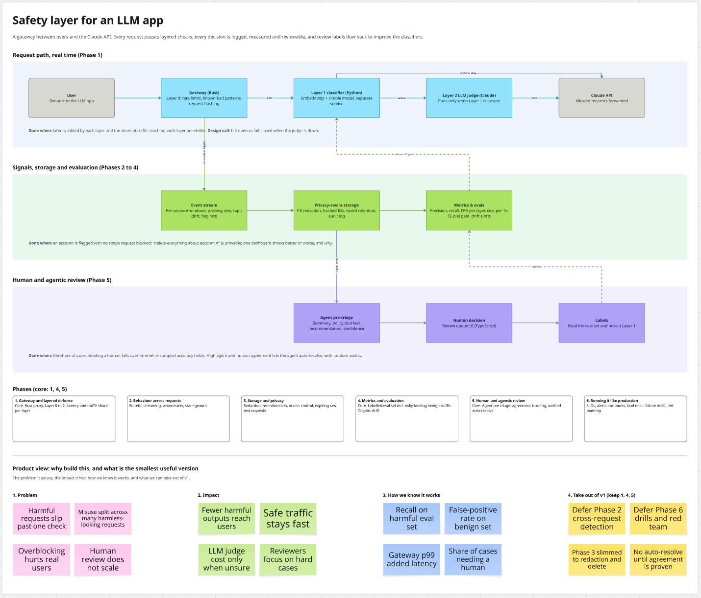

# sieve
A tiered safety gateway for LLM apps: cheap checks first, LLM judge only when unsure

When you put an LLM into production, you face a tradeoff between safety, latency, cost, and user friction. I designed a safety gateway that optimizes all four:

- Safe traffic stays fast: Low-risk requests pass through cheap, deterministic Rust checks without added latency.

- Controlled costs: We only pay for an expensive LLM judge on the small fraction of ambiguous edge cases.

- Scalable human review: Instead of humans reviewing everything, an AI pre-triages flagged cases, and human labels feed directly back into our evaluation sets and lightweight classifiers so the manual workload shrinks over time."

